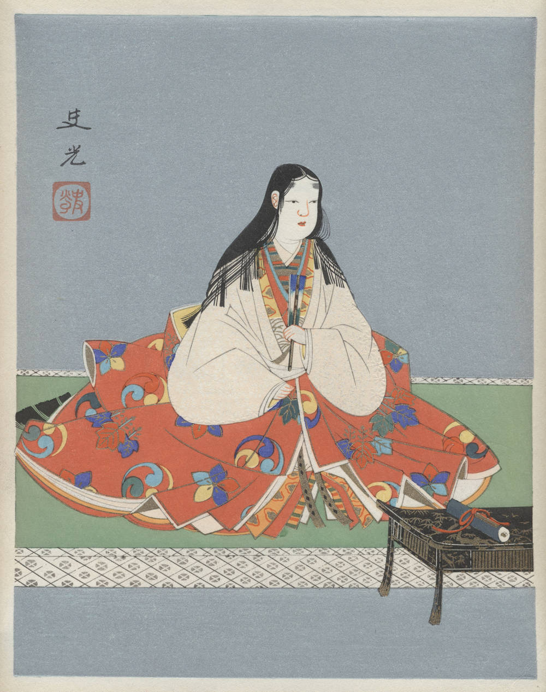

*🇳🇱 [Lees deze pagina in het Nederlands](nl.md)*

## How It All Started 🌸✨

Under the cheerful influence of my ex-girlfriend Hannah, I once bought a piece of Japanese art at an online auction, straight from Japan. When that first scroll arrived, its sober colours and calmness instantly filled me with joy! From that moment on, I completely fell in love with traditional Japanese art, and I kept exploring and discovering. Here I'm sharing some of the artworks that continue to bring me peace, happiness and inspiration.

## More Art

- [Takamizawa Mokuhansha](takamizawa_mokuhansha/README.md)
- [Woodblock Printing Uchida](Wood_Block_Printing_Uchida/README.md)
