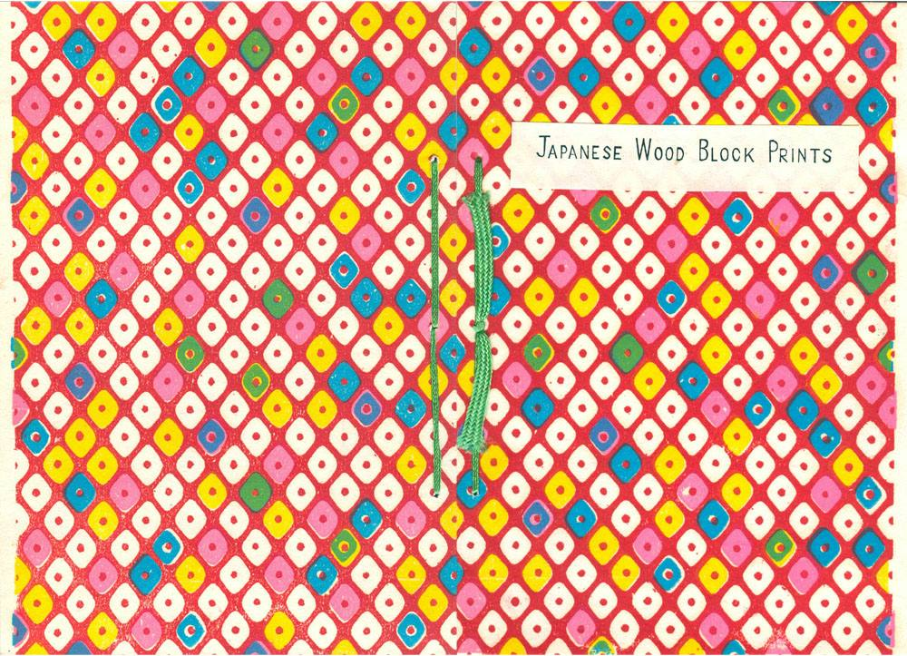
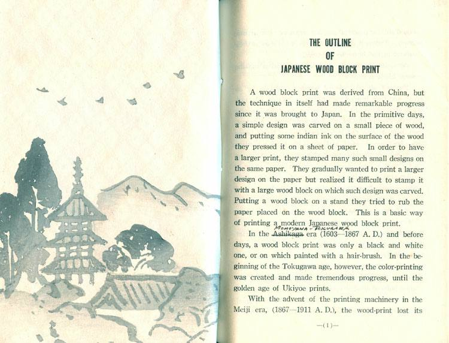
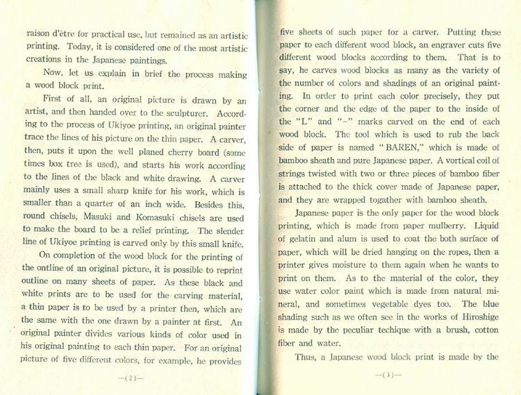
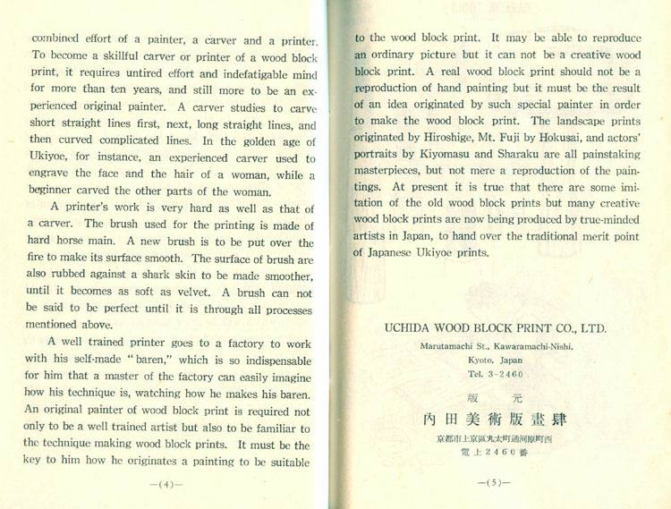
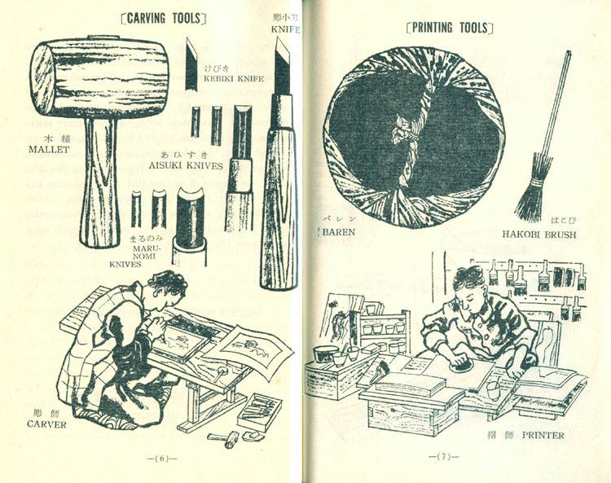
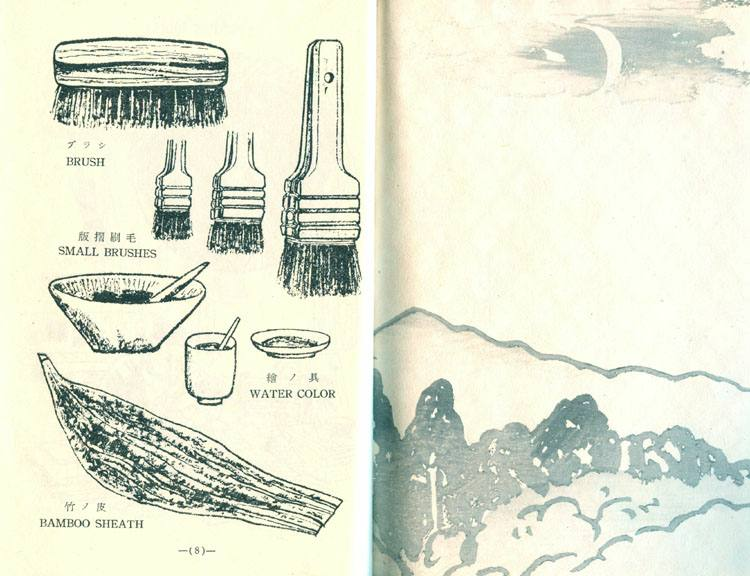
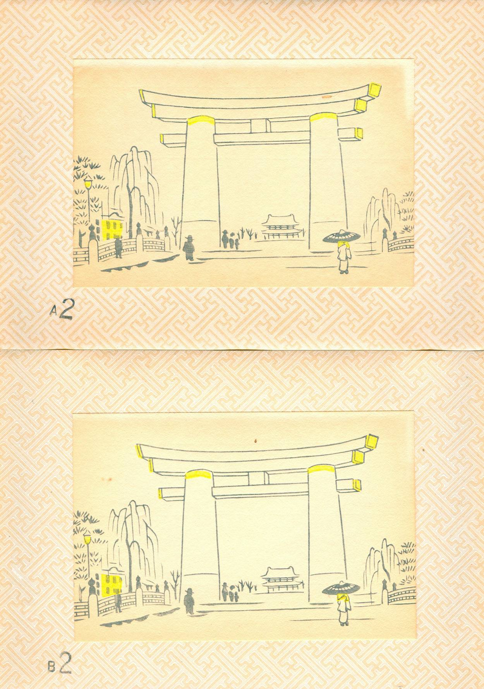
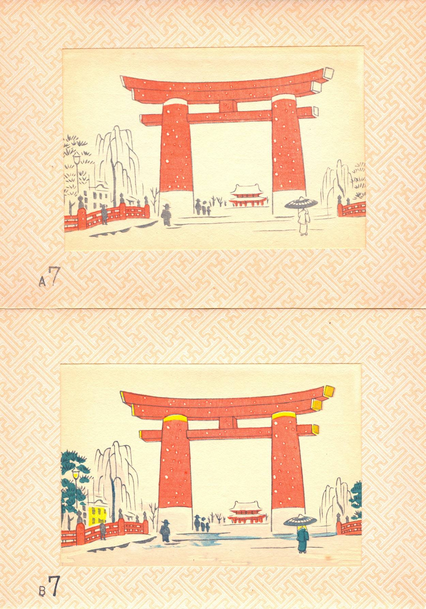
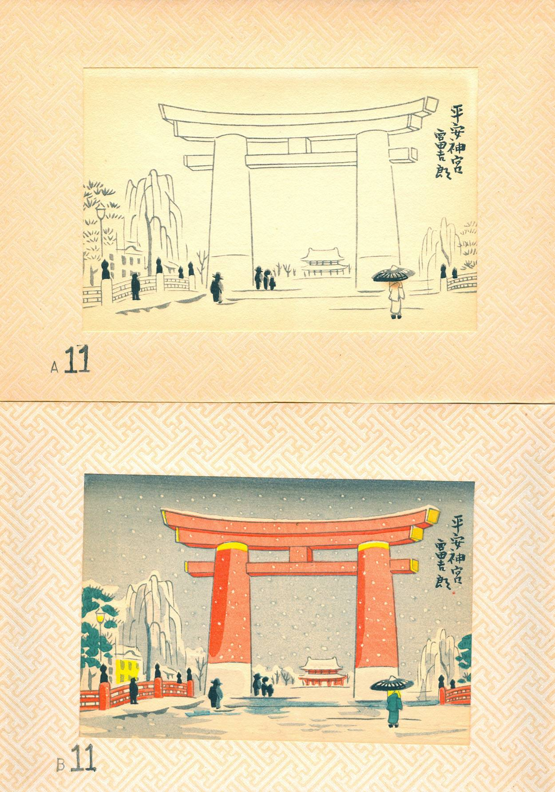
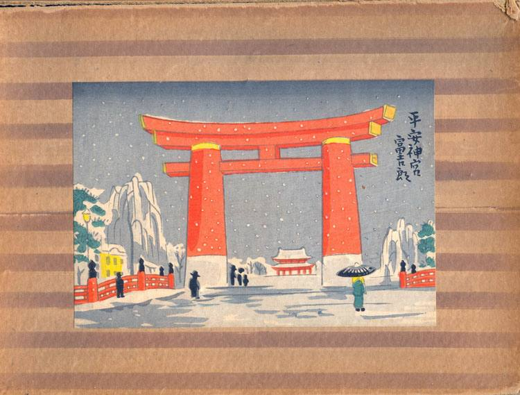

> 🤖 *Deze pagina is met AI vertaald uit het Engels. [Lees het origineel in het Engels](README.md).* Het origineel is een Engelstalig boekje uit ongeveer 1950; de vertaling volgt de inhoud, niet de ouderwetse stijl.

# Een overzicht van de Japanse houtsnededruk

#### Kyoto, Uchida Wood Block Printing Co., Ltd., zonder datum (ca. 1950)

Japanse houtsnededrukken
Uchida Wood Block Printing Co., Kyoto

---

De houtsnededruk komt oorspronkelijk uit China, maar de techniek heeft zich sterk ontwikkeld sinds ze naar Japan werd gebracht. In de begintijd werd een eenvoudig ontwerp in een klein stukje hout gesneden; men bracht wat Oost-Indische inkt op het hout aan en drukte het op een vel papier. Om een grotere afdruk te maken, stempelde men veel van zulke kleine ontwerpen op hetzelfde papier. Geleidelijk wilde men een groter ontwerp op het papier drukken, maar men merkte dat het lastig was om dat te stempelen met een groot houtblok waarin zo'n ontwerp was gesneden. Men legde het houtblok daarom op een standaard en wreef over het papier dat op het blok lag. Dit is de basismethode waarmee een moderne Japanse houtsnede wordt gedrukt.

In de Ashikaga-periode (1603–1867 n.Chr.)[^era] en daarvoor was een houtsnede alleen zwart-wit, of werd ze met een penseel ingekleurd.

Aan het begin van de Tokugawa-periode werd echter de kleurendruk uitgevonden, die enorme vooruitgang boekte, tot aan de gouden eeuw van de ukiyo-e-prenten.

Met de komst van de drukpers in de Meiji-periode (1867–1911 n.Chr.) verloor de houtsnede haar *raison d'être* voor praktisch gebruik, maar ze bleef bestaan als artistieke druktechniek. Tegenwoordig wordt ze beschouwd als een van de meest artistieke vormen binnen de Japanse schilderkunst.

Laten we nu in het kort uitleggen hoe een houtsnede wordt gemaakt.

Allereerst tekent een kunstenaar een origineel ontwerp, dat daarna aan de houtsnijder wordt overgedragen.

Volgens de werkwijze van de ukiyo-e-prent trekt de oorspronkelijke schilder de lijnen van zijn tekening over op dun papier. De houtsnijder legt dat vervolgens op een goed geschaafde plank van kersenhout (soms wordt buxus gebruikt) en begint te snijden volgens de lijnen van de zwart-wittekening. Een houtsnijder gebruikt vooral een klein, scherp mes van minder dan een kwart inch (ongeveer 6 mm) breed. Daarnaast worden ronde gutsen en Masuki- en Komasuki-beitels gebruikt om de plank tot een hoogdrukblok te maken. De fijne lijnen van de ukiyo-e-prent worden uitsluitend met dit kleine mes gesneden.

Is het blok voor het drukken van de omtrek van het origineel klaar, dan kan het op veel vellen papier worden afgedrukt. Omdat deze zwart-witafdrukken als snijmateriaal dienen, gebruikt de drukker dun papier, net als het papier waarop de schilder oorspronkelijk tekende. De schilder verdeelt de verschillende kleuren van zijn origineel over afzonderlijke dunne vellen. Voor een origineel met vijf kleuren levert hij bijvoorbeeld vijf van zulke vellen aan de houtsnijder. Door elk vel op een ander houtblok te leggen, snijdt de graveur vijf verschillende blokken. Met andere woorden: hij snijdt evenveel blokken als er kleuren en schakeringen in het origineel zitten. Om elke kleur precies op de juiste plek te drukken, legt men de hoek en de rand van het papier tegen de binnenkant van de “L”- en “—”-markeringen die aan het eind van elk blok zijn uitgesneden. Het gereedschap waarmee over de achterkant van het papier wordt gewreven, heet de **“BAREN”**; het is gemaakt van bamboeschede en zuiver Japans papier. Een spiraal van touw, gedraaid uit twee of drie bamboevezels, wordt op een dik omhulsel van Japans papier bevestigd, en het geheel wordt in bamboeschede gewikkeld.

Japans papier, gemaakt van de papiermoerbeiboom, is het enige papier dat geschikt is voor houtsnededruk. Een oplossing van gelatine en aluin wordt over het oppervlak van het papier gestreken, dat daarna aan touwen te drogen wordt gehangen; vervolgens behandelt de drukker het papier nog eens wanneer hij erop wil gaan drukken. Als kleurstof gebruikt men waterverf van natuurlijke mineralen, en soms ook plantaardige kleurstoffen. Het blauwe kleurverloop dat we vaak in het werk van Hiroshige zien, ontstaat met een bijzondere techniek met een penseel, katoenvezels en water.

Een Japanse houtsnede is dus het resultaat van de gezamenlijke inspanning van een schilder, een houtsnijder en een drukker. Wie een bekwaam houtsnijder of drukker wil worden, heeft meer dan tien jaar onvermoeibare inzet en doorzettingsvermogen nodig, en nog langer om een ervaren ontwerper te worden. Een houtsnijder leert eerst korte rechte lijnen te snijden, daarna lange rechte lijnen en vervolgens gebogen, ingewikkelde lijnen. In de gouden eeuw van de ukiyo-e sneed bijvoorbeeld een ervaren houtsnijder het gezicht en het haar van een vrouw, terwijl een beginner de andere delen van de vrouw sneed.

Het werk van een drukker is net zo zwaar als dat van een houtsnijder. De kwast voor het drukken is gemaakt van stug paardenhaar. Een nieuwe kwast wordt boven het vuur gehouden om het oppervlak glad te maken. Daarna wordt de kwast over haaienhuid gewreven om hem nog gladder te maken, tot hij zo zacht is als fluweel. Pas als een kwast al deze bewerkingen heeft doorlopen, is hij volmaakt.

Een goed opgeleide drukker gaat naar de werkplaats met zijn zelfgemaakte “baren”, dat zo onmisbaar voor hem is dat de baas van de werkplaats aan de manier waarop hij zijn baren maakt al kan zien hoe goed zijn techniek is.

Van de ontwerper van een houtsnede wordt verwacht dat hij niet alleen een goed opgeleide kunstenaar is, maar ook vertrouwd is met de techniek van het houtsnededrukken. Hij moet weten hoe hij een schilderij ontwerpt dat geschikt is voor de houtsnede. Een gewoon schilderij kan misschien worden gereproduceerd, maar dan is het geen creatieve houtsnede. Een echte houtsnede mag geen reproductie van een handgeschilderd werk zijn, maar moet voortkomen uit een idee dat zo'n kunstenaar speciaal voor de houtsnede heeft bedacht. De landschapsprenten van Hiroshige, de berg Fuji van Hokusai en de acteursportretten van Kiyomasu en Sharaku zijn allemaal zorgvuldig gemaakte meesterwerken, en geen reproducties van schilderijen. Het is waar dat er tegenwoordig ook imitaties van oude houtsneden bestaan, maar oprechte kunstenaars in Japan maken nu ook veel creatieve houtsneden, om de traditionele kwaliteiten van de Japanse ukiyo-e-prent door te geven.

---

---

### Voorbeeld van hoe de kleuren worden toegevoegd

### Eindresultaat met alle kleuren

[^era]: *Noot van de redactie:* het boekje noemt "Ashikaga-periode (1603–1867)", maar dat zijn de jaartallen van de Tokugawa- (Edo-)periode. De Ashikaga- (Muromachi-)periode liep van 1336 tot 1573.
