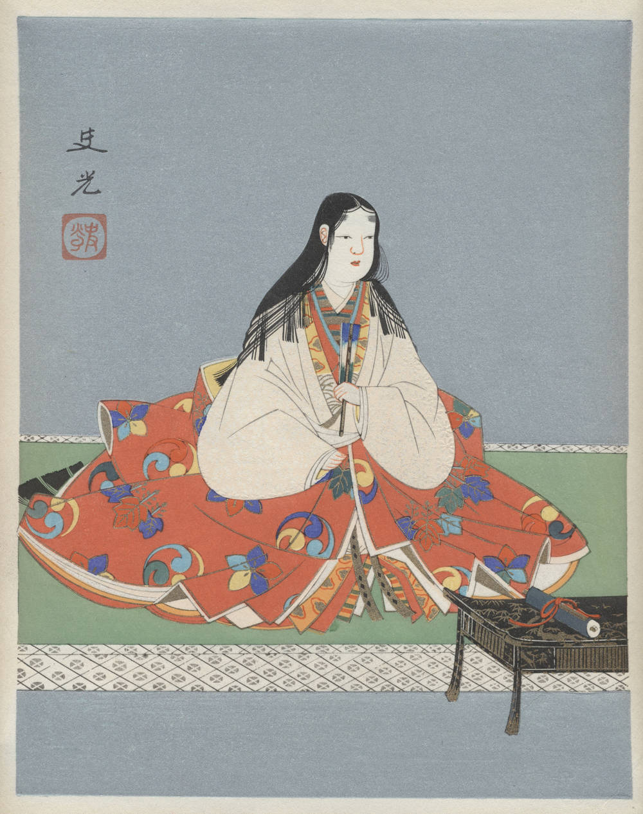

> 🤖 *Deze pagina is met AI vertaald uit het Engels. [Lees het origineel in het Engels](README.md).*

## Hoe het allemaal begon 🌸✨

Onder de vrolijke invloed van mijn ex-vriendin Hannah kocht ik ooit een Japans kunstwerk op een online veiling, rechtstreeks uit Japan. Toen die eerste rol binnenkwam, vervulden de sobere kleuren en de rust ervan me meteen met vreugde! Vanaf dat moment was ik helemaal verliefd op traditionele Japanse kunst, en ben ik blijven ontdekken en verkennen. Hier deel ik een aantal kunstwerken die me nog altijd rust, geluk en inspiratie geven.

## Meer kunst

- [Takamizawa Mokuhansha](takamizawa_mokuhansha/nl.md)
- [Houtsnededrukken van Uchida](Wood_Block_Printing_Uchida/nl.md)
