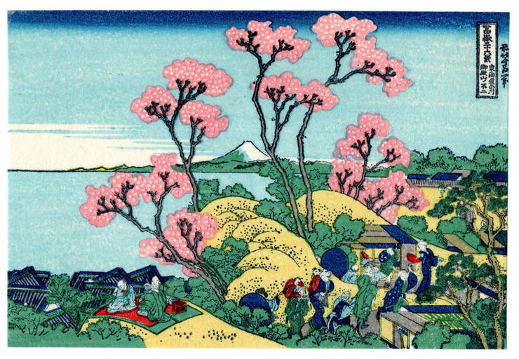
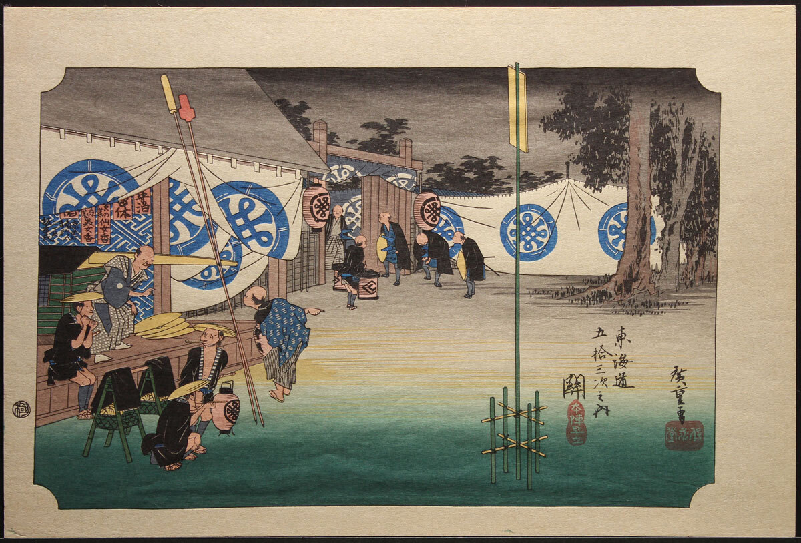
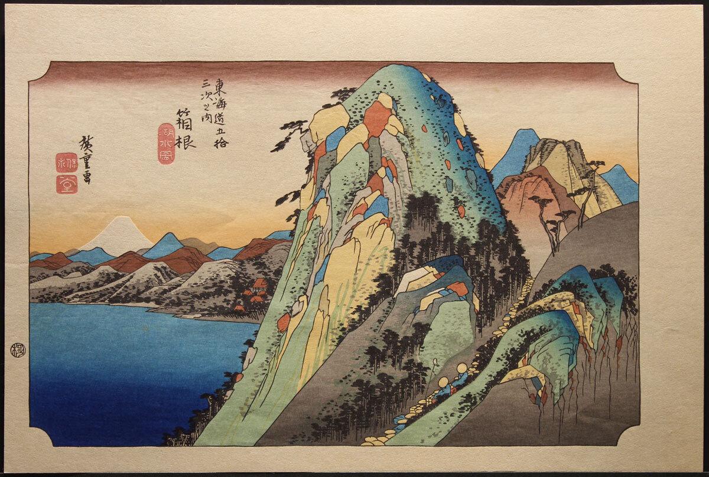
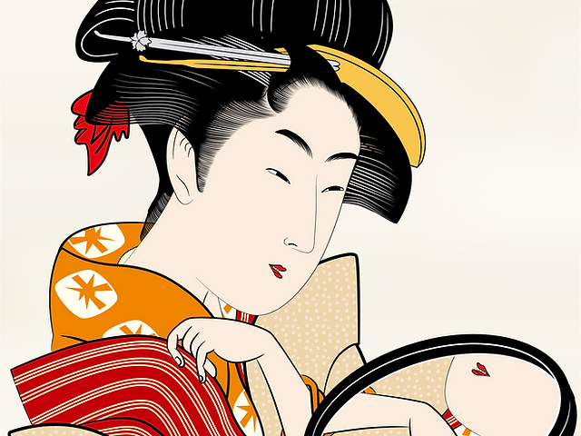

> 🤖 *Deze pagina is met AI vertaald uit het Engels. [Lees het origineel in het Engels](README.md).*

# Kennismaking met Takamizawa Mokuhansha en de kunst van de Japanse houtsnede

Tijdens mijn zoektocht naar *Takamizawa Mokuhansha*, een Japanse uitgever van houtsnededrukken, kwam ik op de website van **George C. Baxley** terecht. Hij deelt prachtige afbeeldingen die laten zien hoe houtsnedes en lithografieën worden gemaakt.

Op zijn site schrijft hij (oorspronkelijke Engelse tekst):

> “Any person is hereby authorized to view, copy, print and distribute this document subject to the following conditions:
> – The document may be used for personal informational purposes only;
> – The document may only be used for non-commercial purposes;
> – Any copy of this document, or any portion thereof, must include this copyright notice.”

*(In het kort: iedereen mag het document bekijken, kopiëren, afdrukken en verspreiden, alleen voor persoonlijke informatie, niet commercieel, en altijd met deze copyrightvermelding.)*

Op basis daarvan denk ik dat ik een aantal van deze mooie afbeeldingen van zijn site mag gebruiken om te laten zien hoe de verschillende houtsnedes en lithografieën werden gemaakt.

Baxleys website bevat ook een boeiende geschiedenis van het **Fujiya Hotel**, compleet met foto's, tekeningen en lithografieën.
Ik heb besloten ze hier te bewaren omdat ik er echt van geniet en ze wil delen, vooral de Japanse kunst, die ik bijzonder inspirerend vind.

---

## Over Takamizawa Mokuhansha (高見沢木版社)

### Oorsprong en achtergrond
Takamizawa Mokuhansha (高見沢木版社) was een **uitgeverij in Tokio**, gespecialiseerd in *mokuhanga* (木版画, houtsnededrukken).
Het bedrijf lijkt te zijn opgericht of geleid door de broers **Masuro Takamizawa** en **Tadao Takamizawa** (高見沢 忠雄).
Het was ongeveer actief van de **jaren dertig tot de jaren tachtig** en stond bekend om **hoogwaardige kleurenreproducties** van klassieke ukiyo-e-prenten, en daarnaast een aantal eigen ontwerpen.

Hun reproducties omvatten vaak complete reeksen historische werken, zoals **Hiroshige’s _De 53 stations van de Tōkaidō_**, met opmerkelijke nauwkeurigheid weergegeven.
Prenten van Takamizawa droegen meestal het zegel van het bedrijf, “高見沢木版社”, dat de echtheid bevestigde en ze onderscheidde van minder goede reproducties uit die tijd.

### Betekenis
Takamizawa Mokuhansha speelde in de 20e eeuw een belangrijke rol in het behouden en populair maken van **traditionele Japanse prentkunst**.
De werkplaats combineerde het vakmanschap van met de hand gesneden blokken en met de hand gedrukte kleuren met moderne distributie, zodat mensen over de hele wereld konden genieten van klassieke ukiyo-e-ontwerpen.

---

## Geselecteerde werken van Takamizawa Mokuhansha

### 🌸 1. Bloemenprent — kersenbloesem (ca. jaren vijftig)

**Uitgever:** Takamizawa Mokuhansha (Tokio)
**Datum:** ca. jaren vijftig
**Techniek:** kleurenhoutsnede op *washi*-papier
**Beschrijving:** een fijne weergave van kersenbloesem in bloei.
**Opmerkingen:** laat de verfijnde *bokashi* (kleurverloop) en subtiele kleurlagen zien die typisch zijn voor Takamizawa-prenten uit het midden van de eeuw.

---

### 🗻 2. De 53 stations van de Tōkaidō – scène I

**Oorspronkelijke kunstenaar:** Utagawa Hiroshige (1797–1858)
**Uitgever:** Takamizawa Mokuhansha
**Uitgave:** naoorlogse herdruk, ca. 1950
**Reeks:** *De 53 stations van de Tōkaidō* (東海道五十三次)
**Opmerkingen:** een van de mooiste naoorlogse reproducties van Hiroshige’s klassieke reisreeks, zorgvuldig gesneden en gedrukt door de vaklieden van Takamizawa.

---

### 🌊 3. De 53 stations van de Tōkaidō – scène II

**Oorspronkelijke kunstenaar:** Utagawa Hiroshige
**Uitgever:** Takamizawa Mokuhansha
**Datum:** ca. 1950
**Techniek:** meerkleurige houtsnede
**Opmerkingen:** nog een voorbeeld uit dezelfde reeks herdrukken, met de uitzonderlijke aandacht van Takamizawa voor lijnvoering en precieze registratie (het passend drukken van de kleuren).

---

### 🉐 4. Uitgeverszegel – Takamizawa Mokuhansha (高見沢木版社)

**Opdruk:** 高見沢木版社 / Takamizawa Mokuhansha
**Gebruik:** te vinden op echte Takamizawa-uitgaven (in de marge of op de achterkant)
**Doel:** bevestigt de echtheid en onderscheidt echte Takamizawa-werken van latere reproducties.

---

## Tot slot

Het verdiepen in de prenten van Takamizawa Mokuhansha gaf me meer waardering voor hoe de Japanse houtsnedetraditie tot ver in de moderne tijd voortleefde.
Elk werk verbindt klassieke kunst met twintigste-eeuws vakmanschap — een stil bewijs van hoe kunstvormen zich ontwikkelen en toch tijdloos blijven.

---

*Alle afbeeldingen en geciteerde teksten worden gebruikt voor niet-commerciële, educatieve doeleinden, in overeenstemming met de copyrightvermelding van George C. Baxley.*
