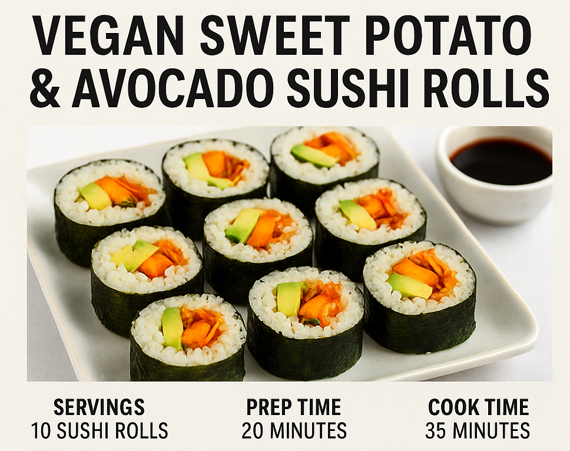

# 🍣 Vegan Sweet Potato & Avocado Sushi Rolls

**Servings:** 10 sushi rolls  
**Prep Time:** 20 minutes  
**Cook Time:** 35 minutes  
**Total Time:** 55 minutes  
**Allergens:** Possibly soy (if present in the kimchi)

---

## 🧠 Fun Fact

Sushi isn't just for fish lovers! These colourful, flavourful rolls combine the **umami of kimchi**, the **creaminess of avocado** and **sweet roasted potato**. A popular choice in plant-based fusion cooking!

---

## 🥗 Ingredients

- 4 cups cooked sushi rice (from 2 cups dry sushi rice)
- 1/4 cup rice vinegar  
- 1 tablespoon sugar  
- 1 teaspoon salt  
- 2 medium sweet potatoes, peeled and cut into thin strips  
- 2 teaspoons olive oil  
- Salt and pepper to taste  
- 2 small avocados, thinly sliced  
- 1/3 cup vegan kimchi, cut into thin strips  
- 10 sheets of nori (seaweed)

---

## 🔪 Instructions

1. **Preheat the oven** to 200°C (392°F).  

2. **Roast the sweet potato:**  
   
   - Spread the strips on a baking tray.  
   - Drizzle with olive oil, salt and pepper.  
   - Toss well and roast for 25–30 minutes. Turn them halfway for even browning.

3. **Season the rice:**  
   
   - Mix the rice vinegar, sugar and salt in a small bowl until dissolved.  
   - Add to the warm cooked rice and fold in gently.

4. **Roll the sushi:**  
   
   - Place a sheet of nori on a bamboo mat or a clean tea towel.  
   - Spread 1/4 of the rice over the nori, leaving the top edge free (about 2 cm).  
   - Lay the roasted sweet potato, avocado and kimchi across the middle.  
   - Roll up tightly with wet hands.  
   - Cut each roll into 6–8 pieces with a sharp, wet knife.

---

## 🍽️ Nutrition (per roll)

- **Calories:** ±210 kcal  
- **Protein:** ±4 g  
- **Carbohydrates:** ±30 g  
- **Fat:** ±7 g  
- **Fibre:** ±4 g
