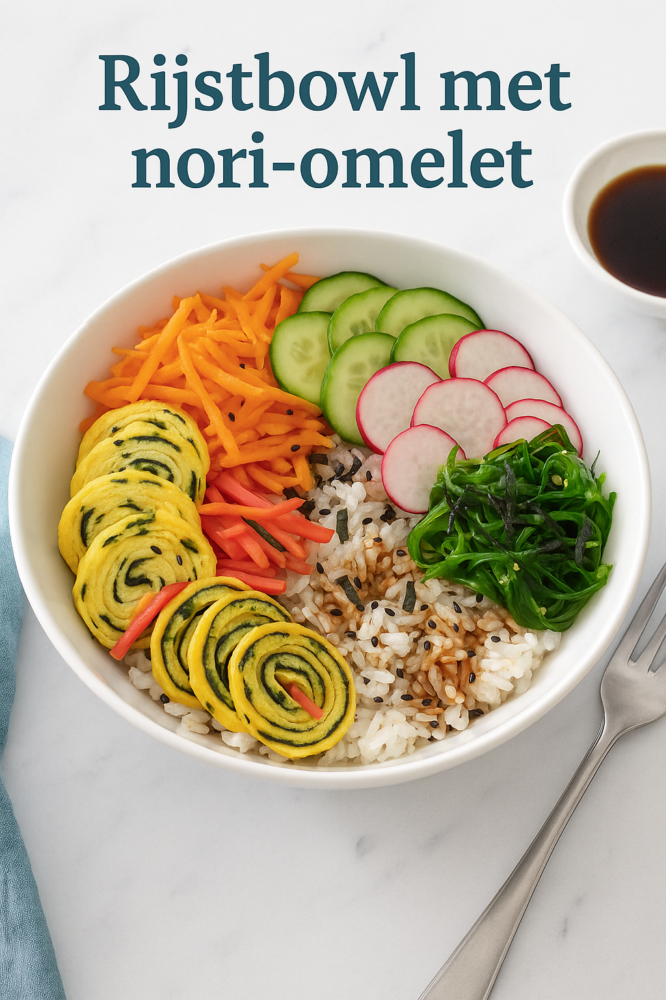

# Rice bowl with nori omelette

A colourful bowl with vegetables, rice and a nori omelette: easy, quick, tasty, and on the table in half an hour.

---

## Ingredients

### Servings

**4**

### Quantities

* **500 g** poke rice
* **5 tbsp** rice vinegar
* **250 g** carrots (winter carrots)
* **4** mini snack cucumbers
* **100 g** radishes
* **2** nori sheets
* **6** free-range eggs
* **50 g** poke ginger sticks
* **2 tbsp** sunflower oil
* **125 g** seaweed salad
* **2 tbsp** soy sauce

---

# Let's get cooking

### 1

Cook the poke rice according to the instructions on the package. Divide it over the bowls, season each bowl with 1 tbsp rice vinegar and let it cool.

### 2

In the meantime, peel and coarsely grate the carrots and mix with the rest of the rice vinegar. Thinly slice the cucumbers and radishes.

### 3

Cut or tear the nori sheets into very small pieces. Beat the eggs and mix with half of the nori and half of the ginger sticks. Season with pepper and, if you like, salt.
Heat the oil in 2 frying pans, pour half of the egg mixture into each pan and cook for 3 min. over medium heat until the egg has set.
Flip and cook for another 1–2 min.
Roll up the omelettes and cut them into thin slices.

### 4

Divide the carrot, cucumber, radish, omelette rolls, the rest of the ginger sticks and the seaweed salad over the rice. Drizzle with the soy sauce and sprinkle with the rest of the nori pieces.
